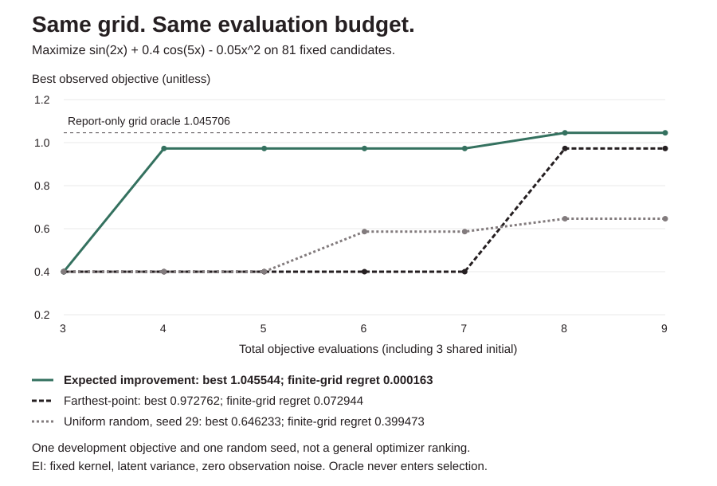

# KernelLab design

## Exact conditioning, explicit assumptions

An isotropic squared-exponential covariance, fixed supplied constant mean and
iid Gaussian observation noise define the model. Training inputs are rows,
not columns. No feature/target normalization, empirical mean estimation or
hyperparameter fitting. All five parameters are explicit: length_scale,
signal_variance, noise_variance, jitter and prior_mean. Signal/noise parameters
are variances, not standard deviations.

Condition using Cholesky and triangular solves. Production code never inverts
a dense matrix. A separate Gauss-Jordan inverse exists only in tests as an
independent tiny reference. An analytic one-point posterior checks mean,
latent variance, LOO and log marginal likelihood. Symmetry, row order,
multidimensional inputs and noiseless interpolation have direct tests.

## Numerical and artifact boundary

The training covariance is K+(noise+jitter)I. Nonpositive pivots fail; no
adaptive jitter, PSD projection, parameter normalization or silent retry.
Prediction latent covariance subtracts the projected training cross-covariance;
observation covariance adds only specified observation noise on the diagonal.
A query repeated twice shares the same latent function value but has independent
observation noise, so noise is not added off diagonal.

Tiny negative posterior diagonals within max(1e-12,signal_variance*1e-10)
are clamped and counted. Material negatives fail. Off-diagonals are not repaired.
Bounds keep the example small and arithmetic manageable; they do not guarantee
conditioning. Everything uses binary64; large integers can lose distinctions.

Artifacts store version kernellab_v1, raw training rows/targets and parameters.
Prediction validates and refactors, rather than trusting serialized alpha or
factors. An artifact contains training data and must be handled accordingly.
This design favors a small transparent JSON format over fast repeated inference.
No dynamic code or model download.

## Marginal likelihood and LOO

Marginal likelihood uses Cholesky log diagonals, not a determinant product.
It is a training-model density, not an external performance score. Its value
includes the explicit training jitter. No optimization uses it here.

For d_i=(A^-1)_ii, compute each d_i as the squared norm of L^-1 e_i.
The code forms only the diagonal, not a dense inverse. Fixed-parameter LOO mean
is y_i-alpha_i/d_i and effective observation variance is 1/d_i. Because A
includes noise+jitter, this conditional variance includes both. Compare it to
explicit refit observation variance plus jitter, not just latent uncertainty.
The supplied constant mean stays fixed; estimating a mean on all targets first
would violate the target-exclusion claim. Own-target perturbation and explicit
refit tests check that exclusion.

LOO here is a row-level conditional diagnostic with fixed assumptions. It does
not retune parameters, respect groups/time, cure leakage or establish coverage.

## Development fixture and adverse arm

Seed 19: 15 evenly spaced training inputs in [-3,3], truth sin(1.5*x)+.15*x,
Gaussian noise SD .12. The same RNG produces 101 noisy test observations at
inputs [-5,5]. Both arms use signal variance1/noise variance.0144/jitter1e-10/
prior mean0. Fixed length scales .8 and5 were manually chosen, without a grid
search. No test field is accepted by fit; the fixture was inspected in
development and is not an untouched benchmark.

Length .8: observation RMSE .6242366399, mean NLL .1040604253, observed
pointwise 2-SD coverage100/101. Length5: RMSE1.0038088074, NLL12.1309060441,
coverage22/101. Unconditioned mean0/observation variance1.0144 gives RMSE.7879412723,
NLL1.2321062355. The wide-kernel adverse arm is kept visible, not silently tuned
away. The fixture is constructed to need shorter-scale variation; no universal
ranking or causal claim follows.

Length .8 inner/outer mean latent variance .00866/.58142, compared with
.00269/.02796 for length5. Smaller model variance does not mean a more accurate
model. Training LML -7.418945/-210.975199 and LOO mean NLL .069448/15.090203
are reported without selection. Model bands are pointwise observation bands,
not simultaneous or distribution-free intervals. The chart shares axes and
plots means, actual latent truth, observations and +/-2 observation SD.

## Finite-candidate expected improvement and budget accounting

```python
from kernellab import suggest
# Use a validated fit(...)["model"] with noise_variance=0.
proposal = suggest(model, [[0.0], [0.5], [1.0]], xi=0.01)
# proposal["suggestion"] contains index, row, mean, latent_variance and EI.
# proposal["candidates"] audits every score and excluded known row.
```

`suggest` is **deterministic maximization only** and requires zero observation
noise. It does not evaluate an objective, spend, call a service or change the
model. Training jitter may still perturb the posterior. For mean mu, latent
SD sigma, best observed target b and nonnegative exploration offset xi:
`delta=mu-b-xi`, `EI=delta*Phi(delta/sigma)+sigma*phi(delta/sigma)`.
At zero variance the exact deterministic limit is `max(delta,0)`, rather than
an unconditional zero. The standalone `expected_improvement` API tests that
limit and a numerical Gaussian quadrature reference. CDF uses erfc for stable
tails; tiny cancellation negatives are bounded at zero.

1-128 unique candidates, matching model width. Exact binary64 coordinate matches
to training rows are excluded, not merely discouraged. Duplicate candidates are
errors; no hidden distance tolerance. Exact ties retain the first eligible
index. An all-known pool returns `status="exhausted"`, `suggestion=null`.
If every eligible EI is zero, the first eligible candidate is still returned;
this is not a convergence claim. The full audit preserves original indices.
Standalone mean/incumbent bounds are [-1e12,1e12], variance [0,1e12], xi [0,1e6].

```sh
python -m kernellab suggest --input suggestion-request.json
# {"model": <zero-noise model>, "candidates": [[0.5], [1.5]], "xi": 0.01}
python -m kernellab optimize-demo
```



The offline optimization demo maximizes `sin(2*x)+0.4*cos(5*x)-0.05*x*x` on an
81-point grid [-4,4], step0.1. Each policy starts at grid indices0/40/80 and gets
six more evaluations: **nine total including initialization**. EI uses fixed
length0.7/signal variance1/noise0/jitter1e-8/prior mean0/xi0.01. Farthest-point
space filling and uniform random without replacement (seed29) have the same
candidate pool and evaluation budget. Neither control uses target values to
choose its next point. The full traces and evaluated targets are returned.

| Policy, 9 evaluations each | Best observed | Finite-grid simple regret |
|---|---:|---:|
| Expected improvement | 1.045544 at x=-2.5 | 0.000163 |
| Farthest-point space filling | 0.972762 at x=1 | 0.072944 |
| Uniform random, seed29 | 0.646233 | 0.399473 |

The grid oracle is 1.045706 at x=-2.4, computed only after all policies finish
for reporting, never for selection. The objective/settings and one random seed
are development examples, without a parameter/seed sweep. No statistical,
universal speedup or continuous-global-optimum claim. Different objectives,
priors, seeds, budgets and candidate pools can reverse the result. This is not
a noisy-EI method, batch acquisition optimizer or safe autonomous experiment
runner. Only the built-in offline demo executes its public toy objective.

## Cost and omissions

n,m<=128, width<=8. Dense factor/LOO O(n^3), training storage O(n^2).
Prediction refactors, then O(m*n^2); optional full covariance O(m^2*n) work
and O(m^2) output storage. No sparse/variational model, learned kernel, ARD,
kernel optimizer, sampling, continuous/batch/noisy acquisition optimizer or scalable production claim.
The CLI emits either a complete JSON result or an error, never a partial report.
The offline demo checks a singular-model rejection and explicit-jitter recovery,
artifact transfer and covariance semantics. CI regenerates the chart.

## Sources

- https://gaussianprocess.org/gpml/chapters/RW2.pdf
- https://gaussianprocess.org/gpml/chapters/RW5.pdf
- https://www.mit.edu/~gfarina/2024/67220s24_L16_bayesian_optimization/L16.pdf
- https://gpax.readthedocs.io/en/stable/acquisition.html
- https://www.gregorygundersen.com/blog/2019/09/12/practical-gp-regression/

Standard Gaussian-process formulas, independently implemented. No new theory.
