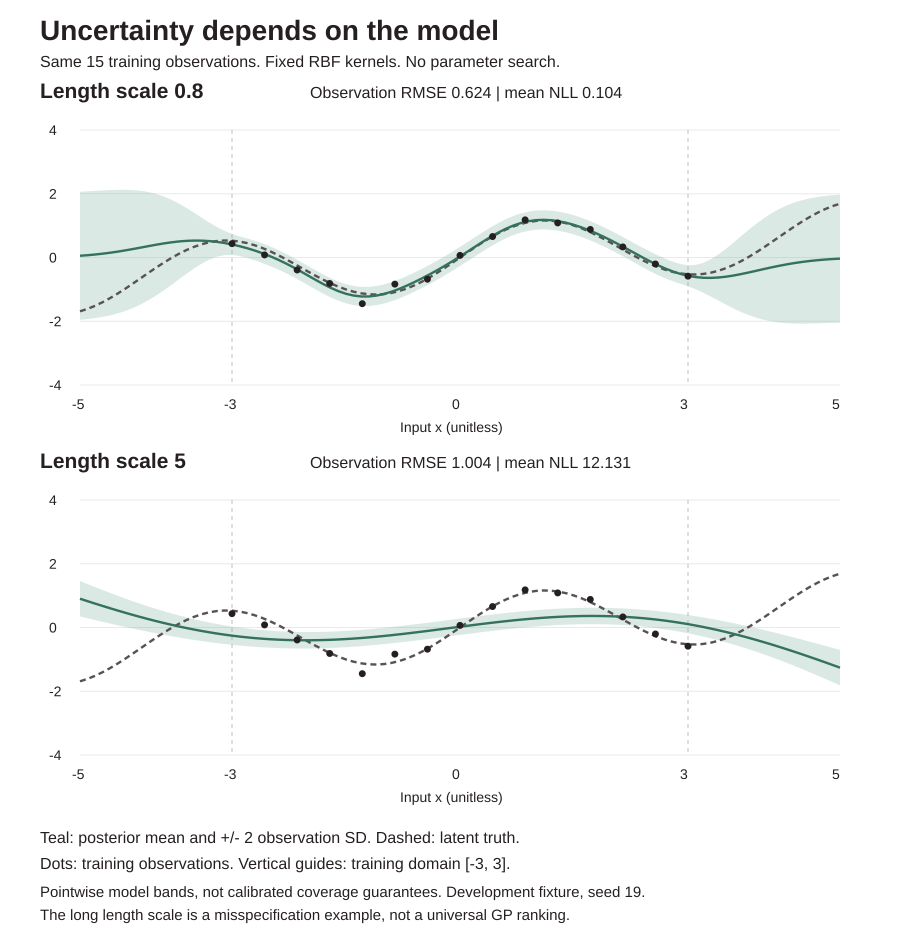
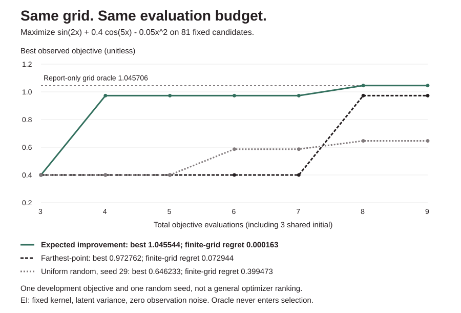

# KernelLab

A small fixed-parameter Gaussian-process library with Cholesky conditioning,
full posterior covariance, linear-contrast uncertainty, target-response weights
and finite-candidate expected improvement. Python uses only the standard
library. The browser inspectors run locally without a server.
Standard GP formulas, not a new method or a large-scale GP package.



## A useful model and a confidently wrong model

```sh
python -m kernellab demo
bash examples/demo.sh
PYTHONPATH=. python examples/render_demo.py
```

The fixture is `sin(1.5*x) + 0.15*x` with independent Gaussian observation noise
SD 0.12, seed 19. Fifteen training points cover [-3,3]; 101 report-only noisy
test observations cover [-5,5]. Both arms use signal variance 1, noise variance
0.0144, explicit jitter 1e-10 and prior mean 0. Only the fixed length scale differs.

| Fixed model | Observation RMSE | Mean observation NLL | Observed pointwise +/-2 SD coverage |
|---|---:|---:|---:|
| Unconditioned prior, mean 0 / variance 1.0144 | 0.7879 | 1.2321 | Not reported |
| RBF length scale 0.8 | 0.6242 | 0.1041 | 100/101 (0.9901) |
| RBF length scale 5 | 1.0038 | 12.1309 | 22/101 (0.2178) |

For length 0.8, average latent variance is 0.00866 inside the training domain,
0.58142 outside. Length 5 has smaller corresponding variances, 0.00269/0.02796,
but worse predictions on this fixture. Uncertainty can increase away from data
and still be misleading when the kernel, mean or noise assumptions are wrong.
The plot shows **observation** bands; latent function variance is smaller.

Training log marginal likelihood is -7.4189 versus -210.9752; fixed-parameter
LOO mean negative log density is 0.0694 versus 15.0902. These diagnostics are
reported, not optimized. Two manually chosen length scales on development data,
no parameter search or test-based selection routine. The fixture was inspected
during development; it is not an untouched benchmark. Coverage across correlated
function locations from this one fixture is not calibration evidence, a
simultaneous band, a confidence guarantee, or a universal model ranking.

## Finite-candidate expected improvement

```python
from kernellab import suggest
# Use a validated fit(...)["model"] with noise_variance=0.
proposal = suggest(model, [[0.0], [0.5], [1.0]], xi=0.01)
# proposal["suggestion"] contains index, row, mean, latent_variance and EI.
# proposal["candidates"] audits every score and excluded known row.
```

`suggest` is **deterministic maximization only** and requires zero observation
noise. It does not evaluate an objective, spend, call a service or change the
model. Training jitter may still perturb the posterior. For mean mu, latent
SD sigma, best observed target b and nonnegative exploration offset xi:
`delta=mu-b-xi`, `EI=delta*Phi(delta/sigma)+sigma*phi(delta/sigma)`.
At zero variance the exact deterministic limit is `max(delta,0)`, rather than
an unconditional zero. The standalone `expected_improvement` API tests that
limit and a numerical Gaussian quadrature reference. CDF uses erfc for stable
tails; tiny cancellation negatives are bounded at zero.

1-128 unique candidates, matching model width. Exact binary64 coordinate matches
to training rows are excluded, not merely discouraged. Duplicate candidates are
errors; no hidden distance tolerance. Exact ties retain the first eligible
index. An all-known pool returns `status="exhausted"`, `suggestion=null`.
If every eligible EI is zero, the first eligible candidate is still returned;
this is not a convergence claim. The full audit preserves original indices.
Standalone mean/incumbent bounds are [-1e12,1e12], variance [0,1e12], xi [0,1e6].

```sh
python -m kernellab suggest --input suggestion-request.json
# {"model": <zero-noise model>, "candidates": [[0.5], [1.5]], "xi": 0.01}
python -m kernellab optimize-demo
```



The offline optimization demo maximizes `sin(2*x)+0.4*cos(5*x)-0.05*x*x` on an
81-point grid [-4,4], step0.1. Each policy starts at grid indices0/40/80 and gets
six more evaluations: **nine total including initialization**. EI uses fixed
length0.7/signal variance1/noise0/jitter1e-8/prior mean0/xi0.01. Farthest-point
space filling and uniform random without replacement (seed29) have the same
candidate pool and evaluation budget. Neither control uses target values to
choose its next point. The full traces and evaluated targets are returned.

| Policy, 9 evaluations each | Best observed | Finite-grid simple regret |
|---|---:|---:|
| Expected improvement | 1.045544 at x=-2.5 | 0.000163 |
| Farthest-point space filling | 0.972762 at x=1 | 0.072944 |
| Uniform random, seed29 | 0.646233 | 0.399473 |

The grid oracle is 1.045706 at x=-2.4, computed only after all policies finish
for reporting, never for selection. The objective/settings and one random seed
are development examples, without a parameter/seed sweep. No statistical,
universal speedup or continuous-global-optimum claim. Different objectives,
priors, seeds, budgets and candidate pools can reverse the result. This is not
a noisy-EI method, batch acquisition optimizer or safe autonomous experiment
runner. Only the built-in offline demo executes its public toy objective.

## Condition, audit, serialize, predict

```python
from kernellab import fit, predict

report = fit({
    "rows": [[0], [1], [2]],
    "targets": [1, -0.5, 0.7],
    "kernel": {
        "length_scale": 0.8,
        "signal_variance": 1.3,
        "noise_variance": 0.2,
        "jitter": 1e-9,
        "prior_mean": 0.3,
    },
})
posterior = predict(report["model"], [[0.3], [1.4]], full_covariance=True)
# means, latent_variances, observation_variances;
# optional latent_covariance and observation_covariance.
```

`fit` accepts exactly rows/targets/kernel, with all five kernel settings explicit.
No target centering, feature scaling, mean fitting, optimization or default
noise inference happens silently. Model artifacts use `kernellab_v1` and store
validated training rows, targets and settings, not executable code or trusted
precomputed factors. `predict` revalidates and refactors the training covariance;
JSON round trips preserve tested predictions. Training data is present in the
artifact: do not publish an artifact containing sensitive data.

```sh
python -m kernellab fit --input examples/train.json
# Output contains model, log_marginal_likelihood, loo, diagnostics, scope.
python -m kernellab predict --input prediction-request.json
# {"model": <report.model>, "rows": [[0.3]], "full_covariance": true}
```

Both commands support `--input -`. Invalid JSON, schema errors and failed
factorizations exit 2 with stderr and **no partial JSON**. The offline demo
checks artifact transfer, latent/observation variance separation, singular
noiseless rejection and explicit-jitter recovery. CI also regenerates the SVG
and requires it to match the committed chart.

## Numerical contract

For `k(a,b)=signal_variance*exp(-0.5*sum(((a-b)/length_scale)^2))`:

- Factor `A = K + (noise_variance + jitter) I = L L^T`.
- Solve `alpha = L^-T L^-1 (y-prior_mean)` with triangular solves, no dense inverse.
- Posterior mean: `prior_mean + k_*^T alpha`.
- Latent covariance: `K_** - (L^-1 K_*)^T (L^-1 K_*)`.
- Observation covariance adds **noise_variance only** to the query diagonal.
- Log marginal likelihood: `-0.5*(y-m)^T alpha - sum(log(diag(L))) - n/2*log(2*pi)`.

Jitter is an explicit training-covariance perturbation. It changes predictions
and marginal likelihood; it is not automatically added to future observation
noise. No hidden adaptive jitter or matrix repair. A nonpositive Cholesky pivot
fails with a request to reconsider noise or caller-supplied jitter.

Negative posterior diagonals within `max(1e-12, signal_variance*1e-10)` are
clamped to zero and counted; larger negatives fail. This is a stated numerical
tolerance, not an assertion of exact arithmetic. Off-diagonal covariance is not
silently projected to a positive-semidefinite matrix. Very ill-conditioned
inputs can fail even inside the schema bounds.

LOO uses `mu_i = y_i - alpha_i / d_i` and `variance_i = 1/d_i`, where
`d_i = ||L^-1 e_i||^2` is the diagonal of `A^-1`, computed without materializing
the dense inverse. These are **effective observation variances including
training jitter**. This differs deliberately from future prediction variances.
The fixed supplied mean and hyperparameters are held unchanged across folds.
Tests compare every LOO value with an explicit leave-one-out refit and show
that an omitted row's target does not determine its own predicted mean.

## Scope and limits

1-128 training rows and query rows, 1-8 numeric features; coordinates, targets
and supplied mean in [-1e6,1e6]. Length scale in [1e-6,1e6], signal variance in
[1e-12,1e6], noise variance in [0,1e6], jitter in [0,0.01]. Booleans, NaN,
Infinity, mismatched shapes and unknown fields are rejected. Inputs become
binary64 floats, so large integer distinctions may be lost.

Dense factorization and the LOO audit cost O(n^3), storage O(n^2). Prediction
refactors the artifact, then uses O(m*n^2) triangular work; optional joint
covariance adds O(m^2*n) work and O(m^2) storage. Small-data educational scope.
No sparse approximations, learned kernels, ARD, gradients, optimizer, weights,
missing/categorical values, multi-output, sampling, continuous/batch/noisy acquisition optimization,
causal claim, automatic deployment or production-performance promise.

The Gaussian iid noise/RBF/supplied-mean assumptions are substantive. Row LOO
does not protect against group/time dependence, feature leakage or deployment
shift. A marginal-likelihood score is not a test score; optimizing it would
require a separate selection protocol. Model uncertainty is not a substitute
for empirical validation. No paid service, model download or network call.

## Verification

```sh
python -m unittest discover -s tests -v
```

36 tests cover an analytic one-point posterior and marginal likelihood,
Cholesky reconstruction/linear solves, an independent tiny Gauss-Jordan inverse
reference, explicit LOO refits, own-target exclusion, duplicate-point failure
and explicit-jitter recovery, noiseless interpolation, far-field prior return,
variance independence from targets, covariance symmetry/diagonal/quadratic
checks, counted tiny-negative clamping and material-negative rejection, row permutation, multidimensional inputs, bounds/schema validation,
no input mutation, artifact round trips, CLI errors and deterministic metrics.
Additional acquisition tests cover analytic/degenerate EI, independent numerical
Gaussian integration, tail behavior, translation/scaling, exploration offset,
known-row exclusion, exact ties, exhausted/zero-EI pools, duplicate/noisy-input
rejection, CLI audits and equal-budget measured optimization traces.
CI runs Python 3.10-3.13 and the offline demo, regenerating both SVGs.

## Sources and credit

- [Rasmussen & Williams (2006), GPML Chapter 2, Algorithm 2.1](https://gaussianprocess.org/gpml/chapters/RW2.pdf): Cholesky conditioning, predictive uncertainty and marginal likelihood.
- [GPML Chapter 5, equation 5.12](https://gaussianprocess.org/gpml/chapters/RW5.pdf): fixed-parameter leave-one-out conditional means and variances.
- [MIT Bayesian optimization lecture, expected improvement](https://www.mit.edu/~gfarina/2024/67220s24_L16_bayesian_optimization/L16.pdf): acquisition as expected positive improvement (minimization convention).
- [GPax acquisition documentation](https://gpax.readthedocs.io/en/stable/acquisition.html): Gaussian EI formula for maximization. KernelLab uses a deterministic positive-part zero-variance limit and does not reproduce GPax inference or noisy acquisition.
- [Gregory Gundersen, practical GP regression](https://www.gregorygundersen.com/blog/2019/09/12/practical-gp-regression/): explanatory Cholesky treatment.

Independent implementation of standard formulas. No source code copied from a
GP library, synthetic data clearly labeled and no external-performance attribution.
MIT license.

## v0.2: a target edit moves the mean, not the variance

[Open the live conditioning inspector](https://midya8.github.io/kernellab/). Keep both original fixed kernels, all 15 observations and all original metrics while editing one target and an arbitrary query. Signed target-response weights, complete additive terms and separate latent/observation bands make the fixed-assumption boundary visible. Narrower bands still do not rescue the original misspecified model.

43 Python tests and four Node/actual-Chrome tests include 202 complete response witnesses, 3,030 direct target-edit predictions, 48 high-precision tiny-system controls and every original GP/acquisition test. Installed reproduction imports eight modules and runs seven main commands plus full archive regeneration. No new fit selection, causal attribution, calibration or performance claim. [RESPONSE.md](RESPONSE.md) gives derivation, residual/roundoff gates, source distinctions and reproduction.

```sh
python -m kernellab.response_export
python -m kernellab response-report
python -m kernellab response --input examples/response.json
node --test tests/*.cjs
```


## v0.3: the uncertainty of a difference needs the cross terms

[Open the joint-covariance workbench](https://midya8.github.io/kernellab/joint.html). Supply up to eight queries and four signed linear weight rows. Compare `W Sigma W^T` with a diagonal-only law that keeps the same pointwise means and variances but discards dependence. Every covariance, weighted pair term and cross-contrast covariance stays visible, with full JSON input editing and download.

Two synthetic controls have identical pointwise means and variances, yet the variance of their latent difference is `1.729329434` versus `0`. The diagonal-only law gives `1.264241118` in both. Two observations at the same coordinate share one latent value but have distinct iid future noises; their difference variance is `0.4` when the noise variance is `0.2`. Training jitter is not future noise. Mean ±2SD intervals are for one scalar model distribution, not simultaneous bands or empirical coverage guarantees.

```sh
python examples/joint_controls.py
python -m kernellab.joint input.json > report.json
python -m unittest discover -s tests -v
node --test tests/*.cjs
```

58 Python tests and nine Node/actual-Chrome tests retain the earlier 43/four. Independent Decimal80 kernels and pivoted Gauss-Jordan solves check 12 controls plus 72 generated systems. Independent browser LDL versus native Cholesky full reports agree on 12 controls plus 100 generated cases. Actual Chrome checks 24 contrasts, 48 modes, 640 cells, 36 layouts, physical input and two real downloads replayed natively. Installed replay retains all earlier CLI/demo/response results and reproduces all new controls.

The separate API limits training to 16 rows, queries to eight, features to two and weight rows to four. Signed weights in `[-10,10]` are not normalized. Other training bounds remain the earlier contract. Singular query laws are allowed; singular training covariance still refuses without caller-supplied noise/jitter. Raw variance subtractions, small-negative clamps and comparison gates are explicit, not PSD or forward-error certificates. [JOINT.md](JOINT.md) gives the derivation, schema and limits. The earlier GP, acquisition and target-response computations are unchanged.
